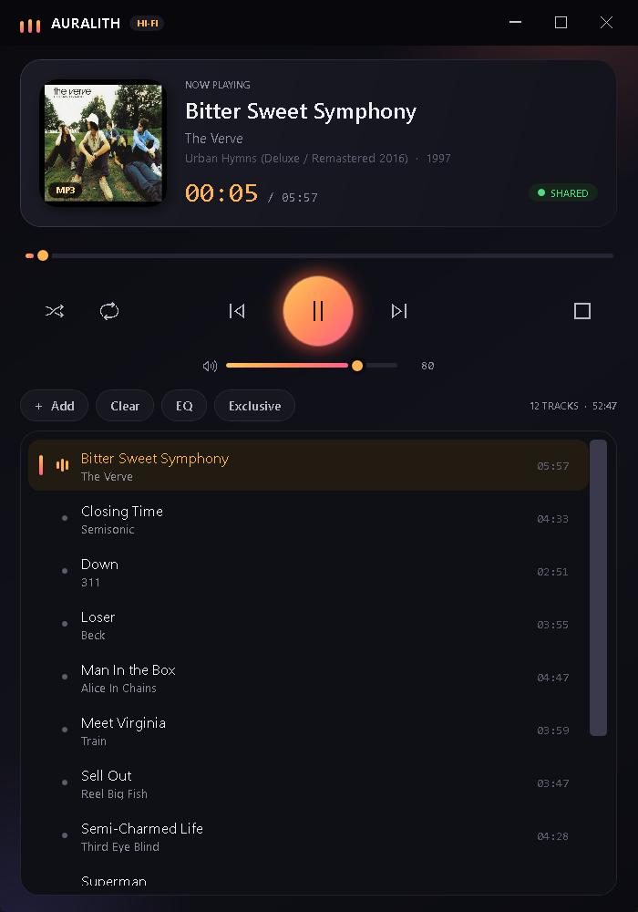
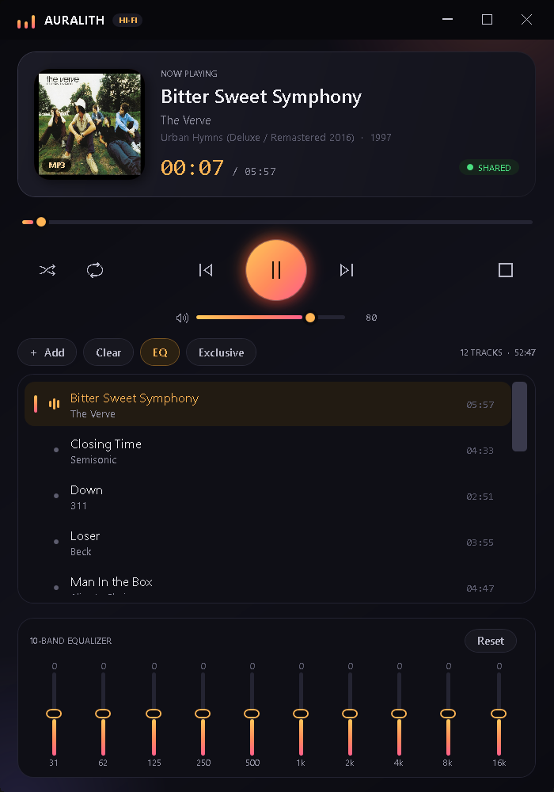
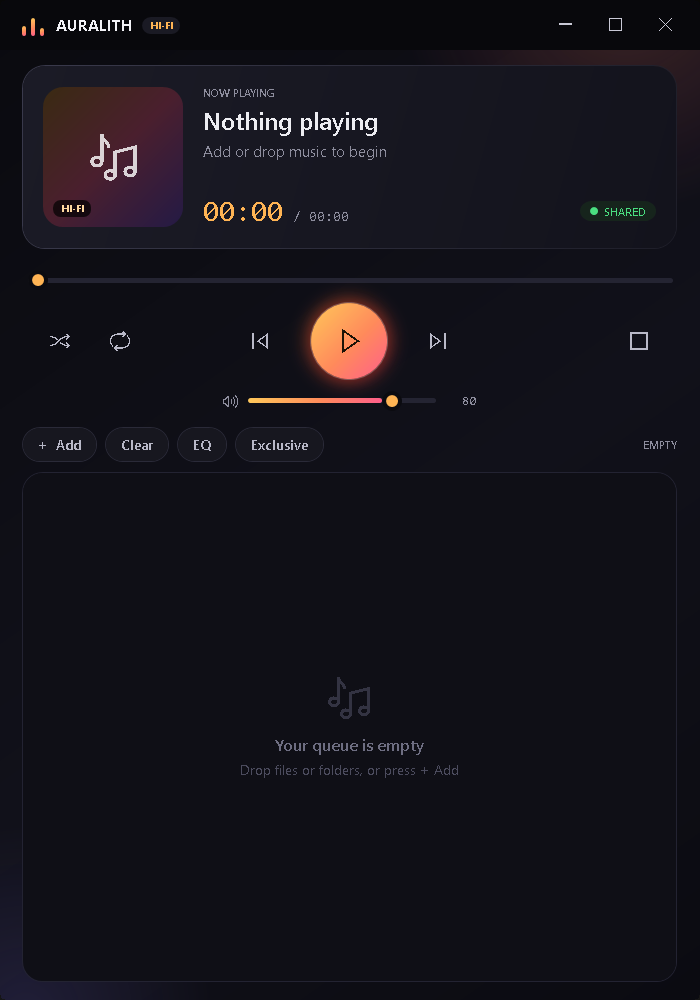

# Auralith

A warm, fast hi-fi music player for Windows. WPF on .NET 8, NAudio output over WASAPI
(shared or bit-perfect exclusive), a real 10-band equalizer, and artwork pulled straight
from your files.



## Features

- **WASAPI output** — shared mode by default, one-click **exclusive** mode for bit-perfect playback that bypasses the Windows mixer (falls back to shared automatically if the device is busy).
- **10-band equalizer** — 31 Hz → 16 kHz, ±12 dB per band, double-click a band to reset.
- **Real metadata** — title, artist, album, year, duration, format, and embedded cover art via TagLib#.
- **Album art card** — animated now-playing glow, live seek bar, and keyboard-friendly transport.
- **Queue that behaves** — shuffle, repeat off/all/one, per-track durations, current-track indicator, drag & drop files or whole folders.
- **Format support** — MP3, FLAC, WAV, AIFF, M4A/AAC, WMA, OGG (Windows Media Foundation).
- **Feels native** — dark aurora theme, custom sliders and toggles, animated equalizer logo, and a proper app icon in the taskbar, Start menu, and Add/Remove Programs.

## Screenshots

| Equalizer | Empty state |
| --- | --- |
|  |  |

## Install

[**Download Auralith-Setup.msi**](https://github.com/leosep/Auralith/releases/download/v1.0.0/Auralith-Setup.msi) — 56.9 MB, Windows 10/11 x64.

Run the MSI and Auralith is installed under `Program Files\Auralith` with a Start menu
shortcut and an entry in Add/Remove Programs. All releases live on the
[releases page](https://github.com/leosep/Auralith/releases).

If you build it yourself, the MSI lands at `installer\bin\x64\Release\Auralith-Setup.msi`.

> Unsigned build: SmartScreen may ask for confirmation the first time.

## Build from source

Requirements: Windows 10/11 and the [.NET 8 SDK](https://dotnet.microsoft.com/download/dotnet/8.0).
WiX v7 is restored automatically by NuGet — no separate install needed.

```powershell
.\build.ps1
```

This publishes a self-contained x64 build to `publish\` and produces the MSI at
`installer\bin\x64\Release\Auralith-Setup.msi`.

Run without installing:

```powershell
dotnet run --project src\Auralith.csproj
```

You can also open audio files directly:

```powershell
src\bin\Release\net8.0-windows\win-x64\Auralith.exe "C:\Music\Track.mp3"
```

## Keyboard & mouse

| Action | Shortcut |
| --- | --- |
| Play / pause | `Space` or media play/pause key |
| Next / previous | media next/previous keys |
| Seek | click or drag the progress bar |
| Add files | `Ctrl+O` |
| Remove selected track | `Delete` |
| Play a track | double-click it |
| Reset an EQ band | double-click the band |
| Add music | drag files or folders onto the window |

## Tech

- [.NET 8](https://dotnet.microsoft.com/) + WPF
- [NAudio](https://github.com/naudio/NAudio) — WASAPI, Media Foundation, biquad filters
- [TagLib#](https://github.com/mono/taglib-sharp) — tags and cover art
- Custom biquad 10-band EQ with per-channel filter state
- [WiX Toolset v7](https://wixtoolset.org/) — MSI packaging
